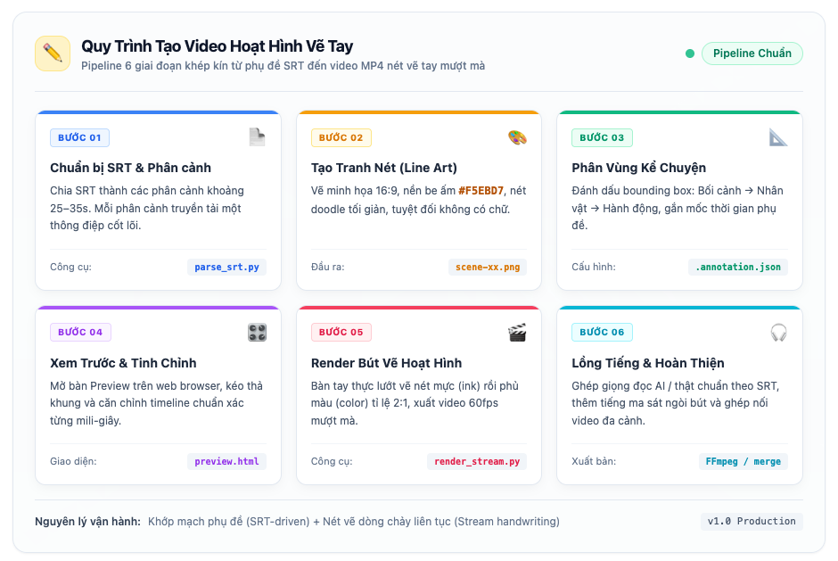
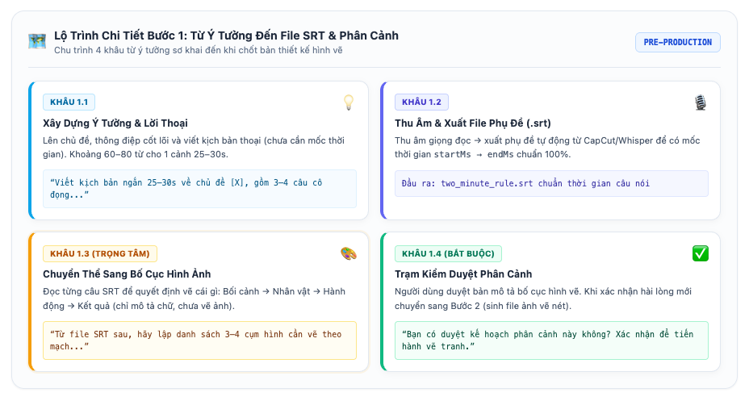

# Quy Trình Tạo Video Hoạt Hình Vẽ Tay (Whiteboard Animation)

Tài liệu hướng dẫn chi tiết quy trình từng bước để chuyển đổi kịch bản / phụ đề SRT thành video hoạt hình vẽ tay hoàn chỉnh với hiệu ứng bút vẽ theo mạch kể chuyện.

---

## 1. Sơ Đồ Quy Trình Tổng Thể

### 📊 Bản đồ đồ họa trực quan (Visual Pipeline)



---

## 2. Chi Tiết 6 Bước Thực Hiện

### Bước 1: Từ Ý Tưởng Đến Kịch Bản, File SRT & Phân Cảnh

- **Mục tiêu:** Phát triển từ một ý tưởng đề tài ban đầu thành kịch bản hoàn chỉnh, xuất file phụ đề SRT có mốc thời gian chuẩn xác và chốt thiết kế bố cục hình vẽ cho từng cảnh.
- **Tiêu chuẩn phân cảnh:**
  - Mỗi phân cảnh (*scene*) có độ dài lý tưởng từ **25 – 35 giây** (tương đương 60 – 80 từ ngữ nói vừa phải).
  - Mỗi cảnh chỉ truyền tải **một thông điệp cốt lõi** và chứa từ **3 đến 4 cụm hình ảnh** trọng tâm.

---

#### 🗺️ Sơ Đồ 4 Khâu Thực Hiện Trong Bước 1 (Visual Roadmap)



---

#### 📌 Chi tiết từng khâu thực hiện:

##### 1.1. Xây dựng Ý tưởng & Viết Kịch bản Lời thoại (Ideation & Scriptwriting)
* **Thực hiện:** Chưa cần quan tâm đến giây hay mốc thời gian. Tập trung sáng tạo nội dung cô đọng: Mở đầu thu hút (Hook) $\rightarrow$ Nội dung giải pháp $\rightarrow$ Kết luận bứt phá.
* **Mẫu Prompt gợi ý:**
  > *"Hãy lên ý tưởng và viết kịch bản lời thoại ngắn gọn (khoảng 60–80 từ, thời lượng đọc tầm 25–30 giây) về chủ đề `[TÊN_CHỦ_ĐỀ]`. Yêu cầu câu từ cô đọng, giàu tính hình ảnh để thuận tiện cho việc vẽ doodle minh họa."*

##### 1.2. Thu Âm & Xuất File Phụ Đề Chuẩn (`.srt`) (Recording & Timestamps)
* **Cách chuẩn trong sản xuất:** Bạn đem kịch bản thoại ở Khâu 1.1 đi thu âm (giọng thật hoặc dùng Text-to-Speech) $\rightarrow$ đưa vào CapCut / Premiere / Whisper để **tự động tạo file `.srt` chuẩn 100%** theo nhịp thở và tốc độ nói thực tế.
* **Cách làm nhanh bằng AI:** Nếu chưa có giọng đọc, có thể nhờ AI chia ước lượng mốc thời gian:
  > *"Từ kịch bản trên, hãy định dạng thành file phụ đề `.srt` hoàn chỉnh có mốc thời gian `startMs --> endMs` kéo dài khoảng 25–30 giây."*
* **Công cụ phân tích cấu trúc:**
  ```bash
  python scripts/parse_srt.py path/to/subtitle.srt --target-sec 30
  ```

##### 1.3. Chuyển Thể Sang Bố Cục Hình Ảnh (Visual Storyboard Strategy)
* **Mục tiêu:** Đóng vai trò "Đạo diễn phân cảnh", chuyển ngữ nghĩa từng câu thoại trong SRT thành mô tả hình vẽ tương ứng *(Lưu ý: Chỉ mô tả bằng chữ, tuyệt đối chưa sinh file ảnh)*.
* **Quy tắc thứ tự kể chuyện:** Luôn sắp xếp từ trái qua phải theo mạch:
  $$\text{Bối cảnh} \longrightarrow \text{Nhân vật / Chủ thể} \longrightarrow \text{Hành động} \longrightarrow \text{Kết quả}$$
* **Mẫu Prompt chiến lược phân cảnh:**
  > *"Dựa vào nội dung file SRT sau: `[DÁN_NỘI_DUNG_SRT]`, hãy phân tích và đưa ra kế hoạch phân cảnh:
  > • Thông điệp cốt lõi của cảnh này là gì?
  > • Tổng thời lượng (`sceneDurationMs`).
  > • Liệt kê 3–4 cụm hình ảnh cụ thể tương ứng với từng mốc thời gian của câu nói."*

##### 1.4. Trạm Kiểm Duyệt Phân Cảnh (Confirmation Checkpoint)
* **Quy tắc bắt buộc:** AI (hoặc bạn) trình bày bản tóm tắt phân cảnh và **dừng lại chờ xác nhận**.
* **Mẫu Prompt duyệt:**
  > *"Dưới đây là kế hoạch phân cảnh và danh sách các hình sẽ vẽ cho Cảnh 1: `[TÓM_TẮT]`. Bạn duyệt bố cục này chưa? Vui lòng **XÁC NHẬN** để bắt đầu sang Bước 2 (sinh file ảnh vẽ nét)."*

---

### Bước 2: Tạo Tranh Vẽ Nét (Line Art)

- **Mục tiêu:** Tạo hình ảnh minh họa bao quát toàn bộ nội dung của phân cảnh đó.
- **Quy chuẩn thị giác (Bắt buộc):**
  - **Tỉ lệ khung hình:** 16:9 (kích thước đề xuất: `1376x768` hoặc `1920x1080`).
  - **Màu nền giấy:** Màu vàng be ấm (mã màu `#F5EBD7`). Tuyệt đối không dùng nền trắng tinh.
  - **Phong cách vẽ:** Nét phác thảo chì xám đậm tối giản (*Notion doodle style*), nhiều khoảng đệm trắng (*negative space*) quanh từng đối tượng.
  - **Màu sắc nhấn nhá:** Hạn chế, chỉ dùng một chút màu cam hoặc xanh dương nhẹ.
  - **Điều cấm kỵ:** Tuyệt đối **không vẽ sẵn chữ, số hay nhãn chữ** vào tranh; không dùng hiệu ứng 3D đổ bóng hoặc chi tiết chụp ảnh thực tế.
- **Đầu ra:** File ảnh nét vẽ `scene-xx.png`.

---

### Bước 3: Phân Vùng Vẽ & Gán Thứ Tự Kể Chuyện (`.annotation.json`)

- **Mục tiêu:** Chia bức tranh thành các phân vùng chữ nhật tương ứng với mạch xuất hiện của câu thoại.
- **Quy tắc thứ tự kể chuyện:**
  $$\text{Bối cảnh ban đầu} \longrightarrow \text{Nhân vật / Đối tượng chính} \longrightarrow \text{Hành động / Biến đổi} \longrightarrow \text{Kết quả}$$
- **Cấu trúc file cấu hình:**
  ```json
  {
    "sceneId": "scene-01",
    "canvas": { "width": 1376, "height": 768 },
    "sceneDurationMs": 26000,
    "elements": [
      {
        "id": "element-1",
        "label": "Tên đối tượng",
        "sequence": 1,
        "subtitle": "Nội dung câu phụ đề khớp với vùng này",
        "region": { "x": 40, "y": 220, "width": 380, "height": 350 },
        "reveal": {
          "direction": "top_to_bottom",
          "startMs": 500,
          "durationMs": 4700,
          "maskPaddingPx": 20,
          "protectedRegions": []
        },
        "handPath": { "start": [230, 240], "end": [230, 550], "easing": "easeInOut" }
      }
    ]
  }
  ```
- **Kiểm tra vùng vẽ bằng hình ảnh:**
  ```bash
  python scripts/render_annotation_preview.py scene-xx.png scene-xx.annotation.json scene-xx-preview.png
  ```
- **Đầu ra:** File `scene-xx.annotation.json` và ảnh sơ đồ phân vùng `scene-xx-preview.png`.

---

### Bước 4: Xem Trước & Tinh Chỉnh Trên Bàn Preview Web

- **Mục tiêu:** Kéo chỉnh trực quan tọa độ và thời gian hiển thị trước khi render video thật.
- **Cách mở bàn làm việc:**
  Mở tệp `assets/preview.html` trên trình duyệt:
  ```bash
  open assets/preview.html
  ```
- **Thao tác:**
  1. Nhấn nút mở thư mục và chọn thư mục chứa tệp ảnh + file `.annotation.json`.
  2. Kéo thả các cạnh của hộp chữ nhật để bao trọn đối tượng vẽ.
  3. Chỉnh mốc thời gian bắt đầu/kết thúc (ms) để khớp chính xác với giọng đọc.
  4. Nhấn **Play** để xem mô phỏng thứ tự các nét xuất hiện.
  5. Nhấn **Save** để cập nhật lại file JSON.

---

### Bước 5: Render Video Hoạt Hình Vẽ Tay (Whiteboard Rendering)

- **Mục tiêu:** Xuất ra file video MP4 với hiệu ứng bàn tay cầm bút lướt vẽ liên tục.
- **Cơ chế hoạt động:**
  - **Nét vẽ liên tục (Stream):** Bút vẽ phác thảo các đường nét thô (`ink`) trước $\rightarrow$ phủ màu nhẹ (`color`) theo sau theo tỉ lệ 2:1.
  - **Bàn tay thực:** Di chuyển tự nhiên theo các tọa độ nét vẽ và vùng chữ nhật.
  - **Mặt nạ che giấu:** Các đối tượng tương lai bị che hoàn toàn, các đối tượng đã vẽ được giữ lại trên trang giấy.
- **Lệnh thực thi:**
  ```bash
  python scripts/render_stream_whiteboard.py scene-xx.png scene-xx.annotation.json scene-xx.mp4
  ```
- **Đầu ra:** File video hoạt hình `scene-xx.mp4` (độ phân giải 1080p/600p, 60fps).

---

### Bước 6: Lồng Tiếng, Âm Thanh & Ghép Cảnh

- **Lồng tiếng (Voiceover):** Dùng file thu âm người thật hoặc tạo giọng AI theo chuẩn timeline của từng câu phụ đề SRT.
- **Ghép âm thanh vào video qua FFmpeg:**
  ```bash
  ffmpeg -y -i scene-xx.mp4 -i voiceover.wav -c:v copy -c:a aac -shortest scene-xx-final.mp4
  ```
- **Ghép nhiều phân cảnh thành một video dài:**
  Nếu kịch bản gồm nhiều phân cảnh (`scene-01`, `scene-02`...), sử dụng công cụ gộp cảnh:
  ```bash
  python scripts/merge_scenes.py --scenes-dir path/to/scenes --output full_video.mp4
  ```

---

## 3. Danh Mục Công Cụ & Thư Mục Dự Án

| Tệp / Thư mục | Chức năng chính |
|---|---|
| `scripts/prepare_env.py` | Tự động tạo môi trường ảo Python `.venv` và cài thư viện đồ họa |
| `scripts/parse_srt.py` | Phân tích phụ đề SRT và gợi ý phân cảnh |
| `assets/preview.html` | Bàn làm việc web trực quan để chỉnh sửa vùng và timeline |
| `scripts/render_annotation_preview.py` | Xuất ảnh sơ đồ các hộp chữ nhật phân vùng |
| `scripts/render_stream_whiteboard.py` | Render video hoạt hình nét vẽ tay bảng trắng |
| `scripts/merge_scenes.py` | Ghép nhiều phân cảnh video thành một video duy nhất |
| `assets/drawing-hand.png` | Hình ảnh bàn tay cầm bút dùng trong diễn hoạt |
